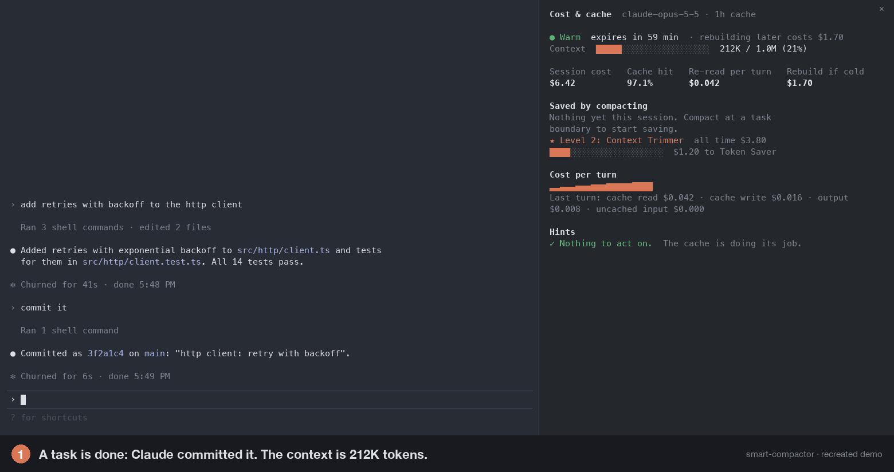
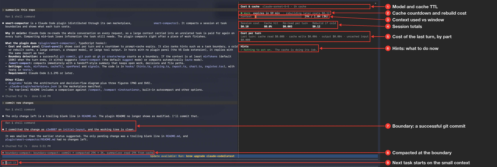
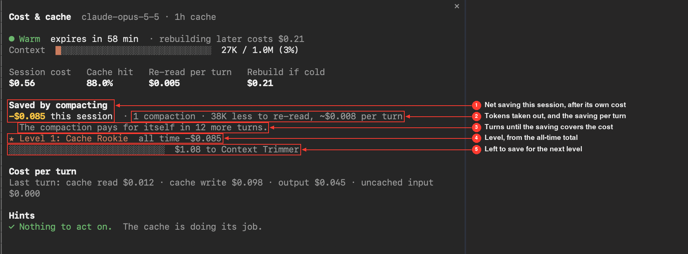
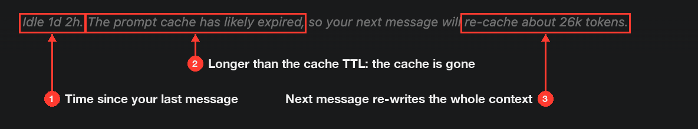

# smart-compactor

A Claude Code plugin that compacts your session at **task boundaries**, when you have
finished one piece of work and are about to start the next. The summary is written as a
handoff for the next task, and a cost & cache panel shows what each turn costs.




Claude Code re-reads the whole conversation on every request, so a large context carried
into an unrelated task is paid for again on every turn. Compacting mid-task saves money but
loses what the task still needs. The plugin aims for the point in between: right after the
work is done.

The plugin lives in [plugin/smart-compactor/](plugin/smart-compactor/).

## Why I built this

I looked at where my Claude spend went. Very little of it paid for Claude writing code:

| Where the money went | Share of cost |
|---|---|
| Cache reads: re-reading the conversation on every request | 56% |
| Cache writes: writing the conversation to the cache, and again after each break | 30% |
| Output: what Claude writes | 15% |

About 85% of the bill paid for carrying context, not for doing work. And the cost follows
the 80/20 rule: a few sessions and a few requests drive most of it.

- The top 10% of sessions made 83% of all cache reads. The top 5 sessions alone made 57%.
- Requests with more than 500K tokens of context were 12% of requests and 38% of cost.
- Writing the cache again after an idle break of more than 5 minutes was 14% of cost.
- What gets re-read is mostly old work: Claude's earlier answers (45% of cache reads) and
  output from Bash and Read (25%). My own prompts were under 1%.

The expensive sessions had the same shape: one long conversation that moves from task to
task and carries everything from the earlier tasks into every request of the next one. I
rarely compacted them, because `/compact` at the wrong moment loses what the current task
still needs, and the right moment, just after a task is done, is easy to miss.
smart-compactor watches for that moment. Most sessions are cheap already, so the plugin
only steps in once the context is large (150K tokens by default), where the 20% that costs
80% lives.

The shares are computed at list price from my local Claude Code transcripts.

### What it would have saved

Had the plugin run over those sessions, the replay study puts the saving at:

| Judge | Net saving |
|---|---|
| Claude Sonnet 5.5 (the default), right every time | 33% |

This uses the default `minTokens` of 150K and counts the cost of the summaries and the
judge calls. The plugin compacts 42 times and never mid-task.

See [Why these defaults](#why-these-defaults) for the other policies the study compared.

## What it looks like

A session in the Claude Code CLI: the transcript on the left, the cost & cache panel on the
right. The user asks Claude to commit, and the plugin compacts as soon as that turn ends.
That is `auto` mode with `judge=off`; items 7 and 8 say what the default Sonnet judge does
instead (see also [How it decides](#how-it-decides)).



The cost & cache panel:

1. **Header**: the model of the main conversation and the cache TTL (the `cacheTtl` setting).
2. **Cache countdown**: whether the prompt cache is warm, how long until it expires, and what
   it costs to write the context to the cache again if you come back after that.
3. **Context**: tokens in the context against the model's window (here 29K of 1M).
4. **Session totals**: cost so far; cache hit, the share of input read from the cache;
   re-read per turn, what the current context costs on every request; rebuild if cold, the
   cost of writing it to the cache again.
5. **Cost per turn**: the last turn split into cache read, cache write, output and uncached
   input.
6. **Hints**: ranked suggestions such as a task boundary, an expiring cache or a large
   context. Here there is nothing to act on.

The task boundary, as `judge=off` handles it:

7. **Boundary signal**: Claude runs a successful `git commit`. With `judge=off` a commit, push
   or PR marks the end of a task. With the default Sonnet judge it doesn't compact by itself:
   it only arms the compaction before the cache expires, in case no prompt follows.
8. **Compaction**: when the turn ends, the plugin compacts with a handoff summary. The
   context drops from 29K to 3K tokens, and the summarizer reads the 29K from the cache, which
   costs much less than reading it fresh. With the judge, this happens when you send the next
   prompt and the judge sees a natural break.
9. **Next task**: the next prompt ("push it") runs on the 3K summary instead of the full 29K.

The screenshot comes from an earlier build named `boundary-compact`, from before the judge
existed, with a low `minTokens` so that it compacts a small session. The notice at 8 carries
the old name; the current plugin prints `smart-compactor: commit → compacted …`. The defaults
are `auto` mode, the Sonnet judge and 150K tokens. In the VS Code extension the panel replies
as text instead (see [CLI and VS Code](#cli-and-vs-code)).

### Saved by compacting

The panel right after one compaction on Claude Opus 5.5:



1. **Net saving this session**: what the compactions saved, minus what they cost. The cost
   is the summarizer's request plus writing the smaller context to the cache. Right after a
   compaction it is negative, here −$0.085.
2. **Per-turn saving**: the compaction took 38K tokens out of the context. Each later turn
   no longer re-reads them, which saves about $0.008 a turn.
3. **Payback**: how many more turns until the saving covers the cost, here 12. After that
   the net turns positive.
4. **Level**: the all-time total across sessions sets the level, from Cache Rookie to
   Compaction Legend.
5. **Next level**: the bar and how much more to save to reach it. Context Trimmer starts at
   $1, so $1.08 is left from −$0.085.

### Coming back after a break

When you return to a session, Claude Code shows its own notice. This one is from the VS
Code extension:



1. **Idle time**: how long since your last message, here a day and two hours.
2. **Cache expired**: the prompt cache lasts for its TTL (5 minutes or 1 hour), so after a
   longer break it is gone.
3. **Re-cache**: your next message writes the whole context to the cache again. A cache
   write costs many times a cache read: 40 times on Claude Opus 5.5 with the 1-hour TTL.

The notice counts tokens. The plugin's cache countdown and its **Cache is cold** hint put a
price on them, and suggest `/clear` if you are starting something new. For a 133K context on
Claude Opus 5.5 they read:

```
○ Cold: the next message re-writes 133K ($1.06)
◆ Cache is cold (~$1.06 at stake). Your next message re-writes 133K ($1.06). Starting
  something new? /clear and restate the task instead.
```

## Install

The plugin works in the Claude Code CLI and in the VS Code extension. Both need Claude Code
2.1.295 or later. The VS Code extension draws no plugin window, so the cost & cache panel
shows there as a text reply instead (see [CLI and VS Code](#cli-and-vs-code)).

### 1. Update Claude Code to 2.1.295 or later

**Claude Code CLI**

```bash
claude --version
```

If the version is lower and you installed with Homebrew, switch to the `claude-code@latest`
cask. The plain `claude-code` cask lags behind (2.1.286 at the time of writing), and the
two casks can't be installed side by side:

```bash
brew uninstall --cask claude-code
brew install --cask claude-code@latest
claude --version        # 2.1.295 (Claude Code) or later
```

Later updates: `brew upgrade --cask claude-code@latest`. If you used the native installer
instead of Homebrew, run `claude update`.

**VS Code extension**

The extension ships its own copy of Claude Code, so Homebrew doesn't update it. Open the
Extensions view (`Cmd+Shift+X`), find **Claude Code** and update it. The extension's version
is its Claude Code version, so it must be 2.1.295 or later.

### 2. Install the plugin

**Claude Code CLI**

From a shell:

```bash
claude plugin install smart-compactor --marketplace Eslamanwar/smart-compactor
```

or inside Claude Code:

```
/plugin marketplace add Eslamanwar/smart-compactor
/plugin install smart-compactor@smart-compactor
```

This adds the marketplace and enables the plugin in `~/.claude/settings.json`.

**VS Code extension**

Run the same shell command in VS Code's integrated terminal (this needs the CLI from step 1).
The extension reads the same `~/.claude/settings.json`, so the plugin is enabled there too.
Open a new conversation in the extension to load it.

### 3. Set options (optional)

The CLI and the extension share these settings. The defaults (`auto` mode, the Sonnet judge,
150K tokens) work without any settings. To change them, either pass `--config` when installing:

```bash
claude plugin install smart-compactor --marketplace Eslamanwar/smart-compactor \
  --config mode=suggest --config minTokens=100000
```

or run `/plugin configure smart-compactor@smart-compactor` inside the CLI, or edit
`~/.claude/settings.json` by hand. Add the `pluginConfigs` block next to the keys already
in the file; don't replace the file:

```json
{
  "pluginConfigs": {
    "smart-compactor@smart-compactor": {
      "options": {
        "mode": "suggest",
        "minTokens": 100000
      }
    }
  }
}
```

The key is `<plugin>@<marketplace>`, which is `smart-compactor@smart-compactor`. Start a new
session for changes to take effect. All options are listed in the
[plugin README](plugin/smart-compactor/README.md#settings).

### 4. Use it

Run `/cost-panel` for the cost & cache report, or `/smart-compact` to compact now. In
`auto` mode (the default) Claude Sonnet reads each new prompt once the context is large.
If the prompt starts after a natural break, the plugin compacts first and then sends the
prompt. After each automatic compaction, a band above the prompt asks **👍 Yes** or
**👎 No, I was mid-task**, and the judge learns from your answers. In `suggest` mode the
plugin tells you when a git commit, push or PR is a good moment to compact.

The panel also keeps score: **Saved by compacting** shows what your compactions have saved
this session after their own cost, and an all-time total across sessions earns levels
(Cache Rookie → Compaction Legend), as in [Saved by compacting](#saved-by-compacting). See the
[plugin README](plugin/smart-compactor/README.md#what-it-does) for how it is counted.

### CLI and VS Code

| Feature | Claude Code CLI | VS Code extension |
|---|---|---|
| Cost & cache panel | a window that opens when a session starts and on `/cost-panel`, with a live cache countdown and **Compact** / **Dismiss** buttons | no window: `/cost-panel` replies with the same report as text; run it again to refresh |
| Task-boundary suggestion (`suggest`) | a toast, the status line, and `/smart-compact` offered in the prompt | `/smart-compact` offered in the prompt box (press Tab to take it); no toast |
| Compaction (`auto`, `/smart-compact`) | compacts with the handoff summary | runs `/compact` with the same handoff instructions |
| Compaction at natural breaks (`auto`) | Sonnet judges each prompt; 👍 / 👎 above the prompt, or `/smart-compact-rate up\|down` | not yet: the extension's prompts can't be held back, so git commit/push/PR signals decide, as with `judge=off` |
| `openPanel` setting | opens the window at session start | has no effect |

To get the window inside VS Code, run `claude` in the integrated terminal instead of the
extension's chat view.

## How it decides

In `auto` mode (the default):

1. You send a prompt and the context is at least `minTokens` (default 150K).
2. Claude Sonnet reads a short digest: how the session started, your last two prompts, the
   files edited since, the start of the last answer, and the new prompt. It answers whether
   this is a natural break, with a confidence. One check costs well under a cent.
3. At a break with enough confidence, the plugin holds your prompt back, compacts with a
   handoff summary that keeps open work, decisions and file paths, and then sends the prompt.
4. You rate the compaction 👍 or 👎. Each 👎 raises the confidence the judge needs, and
   every rating becomes an example the judge reads from then on, in that project only.

The judge can only decide when you send a prompt, so on its own it would compact after a
long break, with the cache already expired. Then the summarizer reads the whole context at
full price instead of the cache-read price. With the 133K context from
the [Cache is cold](#coming-back-after-a-break) example, on Claude Opus 5.5 and the 1-hour
cache, that is about $0.17 for a warm compaction against up to $1.20 for a cold one. So
after a turn with a git commit, push or PR, if no prompt follows, the plugin compacts 5
minutes before the cache expires (1 minute before with the 5-minute cache). A prompt before
then cancels this, and the judge decides as usual.

In `suggest` mode, a successful `git commit`, `git push` or `gh pr create/merge` on a large
context makes the plugin suggest `/smart-compact`. With `judge` set to `off`, `auto` mode
compacts on those signals instead.

See the [decision flow](diagrams/architecture.md#plugin-decision-flow-smart-compactor) for the full picture.

## How it compares

| Option | When it runs | Summary |
|---|---|---|
| `/compact` | when you type it | general history of the conversation |
| `/compact <instructions>` | when you type it | steered by your instructions |
| autocompact (built in) | when the context nears the window limit | general |
| idle compaction (built in) | after about 55 min idle, context ≥ 200K | general |
| `/clear`, new session | when you run it | none; only CLAUDE.md and memory remain |
| **smart-compactor** | at a natural break, before the next prompt, context ≥ `minTokens` | handoff for the next task |

The plugin uses the same compaction engine as `/compact`. It runs it with handoff
instructions, at a moment you would otherwise have to notice yourself. Autocompact waits
until the window is nearly full, so on a 1M-context model you pay for a very large context
on every turn before it fires, and it often fires mid-task. Idle compaction depends on time,
not on work. The plugin compacts right after a piece of work is done, earlier than either,
and keeps the open work, decisions and file paths.

The trade-off: the judge is sometimes wrong, so some automatic compactions land mid-task.
How often is not measured yet (see [Why these defaults](#why-these-defaults)). Rate them,
and the judge becomes more careful. Set `mode` to `suggest` if you would rather confirm each
one.
Use `/clear` when the next task needs no history, and leave autocompact on as a safety net.

## Why these defaults

From a replay of my own sessions (read these as hypotheses). The
study's scripts and data aren't published, because they are built from private transcripts:

| Finding | Value |
|---|---|
| Share of cost from cache reads (re-reading context) | 56% |
| Share of cost from requests with context > 500K | 38% (12% of requests) |
| Saving from compacting only at true natural breaks (context ≥ 150K) | ~33% |
| Saving from compacting on git commit/push/PR signals | ~15%, but 82% of those compactions happen mid-task |
| Saving from a Claude Haiku 5.5 check at prompt time (confidence ≥ 0.8) | ~16%, 4 of 11 compactions risky, ~$0.0002 per check |

No free signal (git, deploy, tests, builds, finished todo lists) marked a natural break more
often than chance, so the default `auto` mode lets a model decide instead. The judge is
Claude Sonnet 5.5, the model the study used as its reference: compacting where it saw a
break saved about 33%. Its own error rate is unknown, because the study had no labels to
check the reference against. Your 👍 and 👎 are those labels: the plugin learns from them,
and they show how often the judge is right for you. Switch to `suggest` mode if mid-task
compactions cost you more than they save.

See the [judge's flow](diagrams/architecture.md#prompt-time-judge). Set `judge` to `haiku`
for the study's cheaper detector: it starts at confidence 0.8, compacts less often, and
saved about 16% in the replay.

## Repository layout

```
smart-compactor/
├── plugin/
│   └── smart-compactor/           # the plugin
├── diagrams/
│   └── architecture.md            # plugin decision flows (Mermaid)
├── images/                        # screenshots
└── .claude-plugin/marketplace.json
```

## Privacy

The plugin makes no network calls of its own. The judge runs through Claude Code with the
model you pick. The plugin keeps its ratings and savings totals in its own store under
`~/.claude`, on your machine (see the
[plugin README](plugin/smart-compactor/README.md#what-it-does) for what each one holds).

## Limitations

- Prices are list prices as of 2026-10. Other pricing changes the absolute numbers, not the
  ranking of policies.

## Contributing

Issues and pull requests are welcome. To work on the plugin from a clone, see
[Develop](plugin/smart-compactor/README.md#develop).

## License

[Apache License 2.0](LICENSE)
