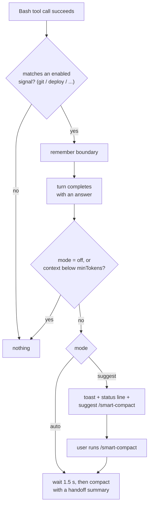
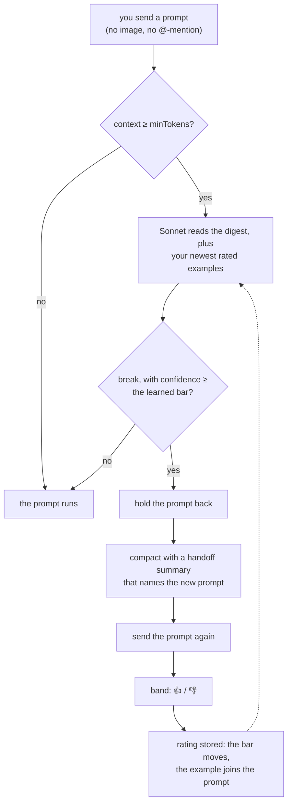

# Architecture

## Plugin decision flow (`smart-compactor`)

The cost & cache panel (`/cost-panel`) runs alongside: it records the cost of each turn,
counts down to cache expiry, and ranks hints (task boundary, cache expiring or cold,
unexpected cache rebuild, large context, cheaper model, large tool output).

The flow above is `suggest` mode, and `auto` mode with `judge=off`.

## Prompt-time judge

In `auto` mode a judge model decides when you send your next prompt.

